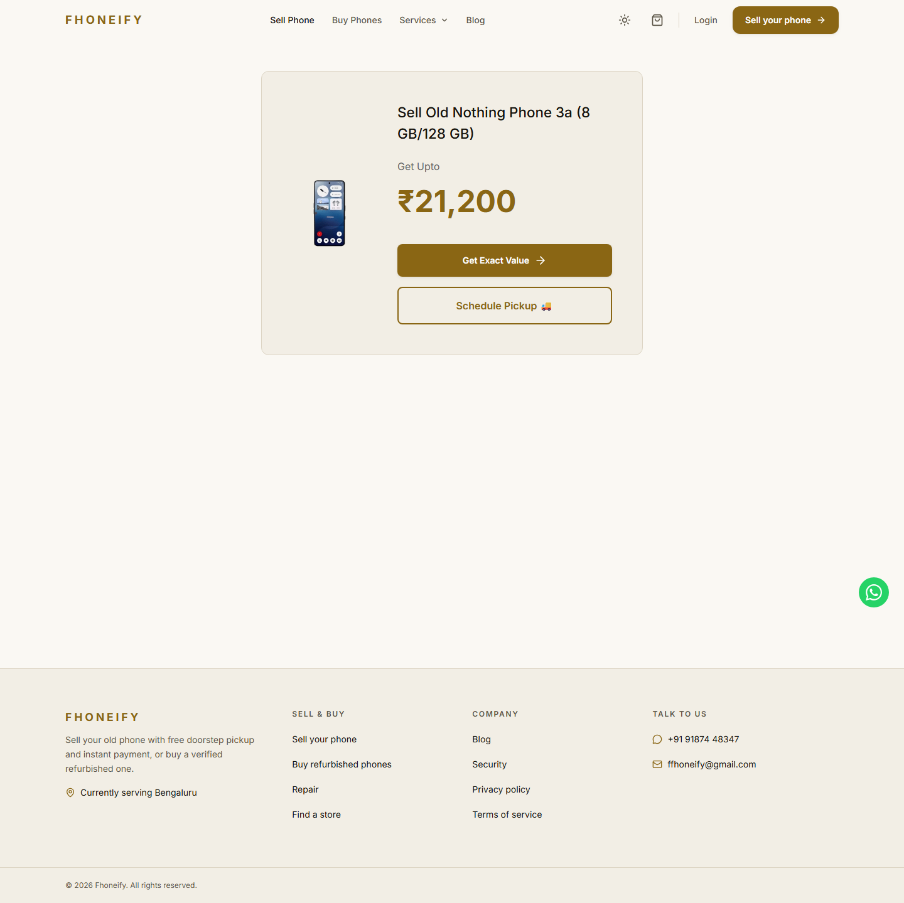
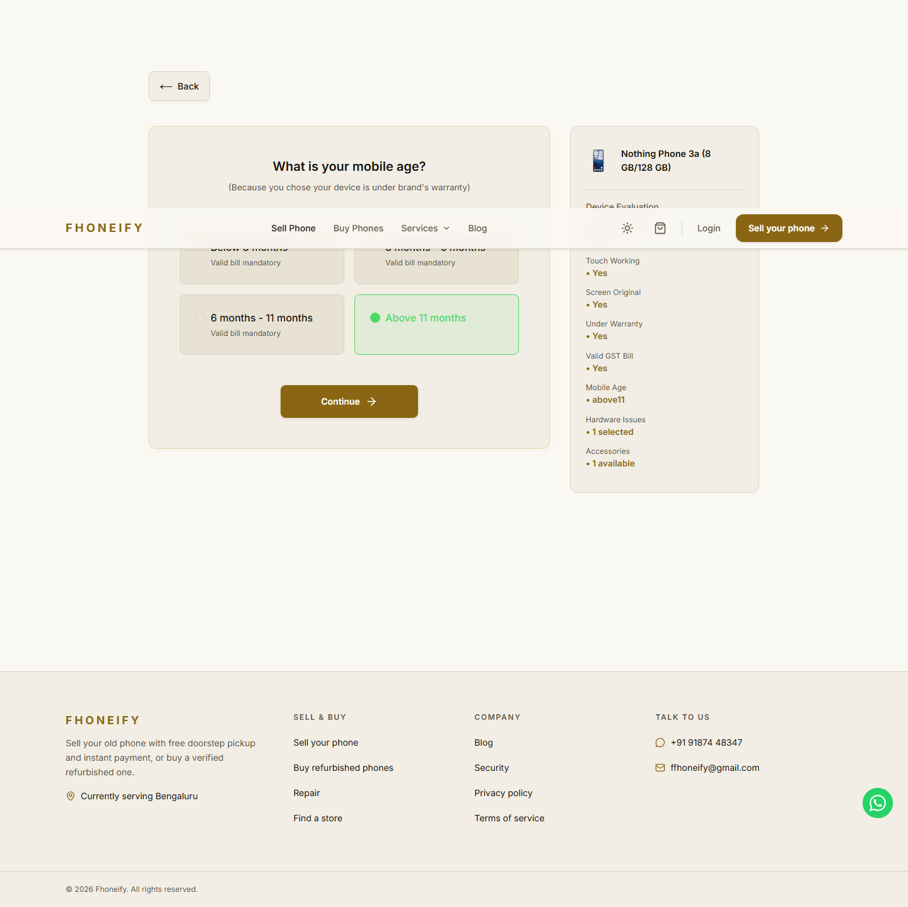
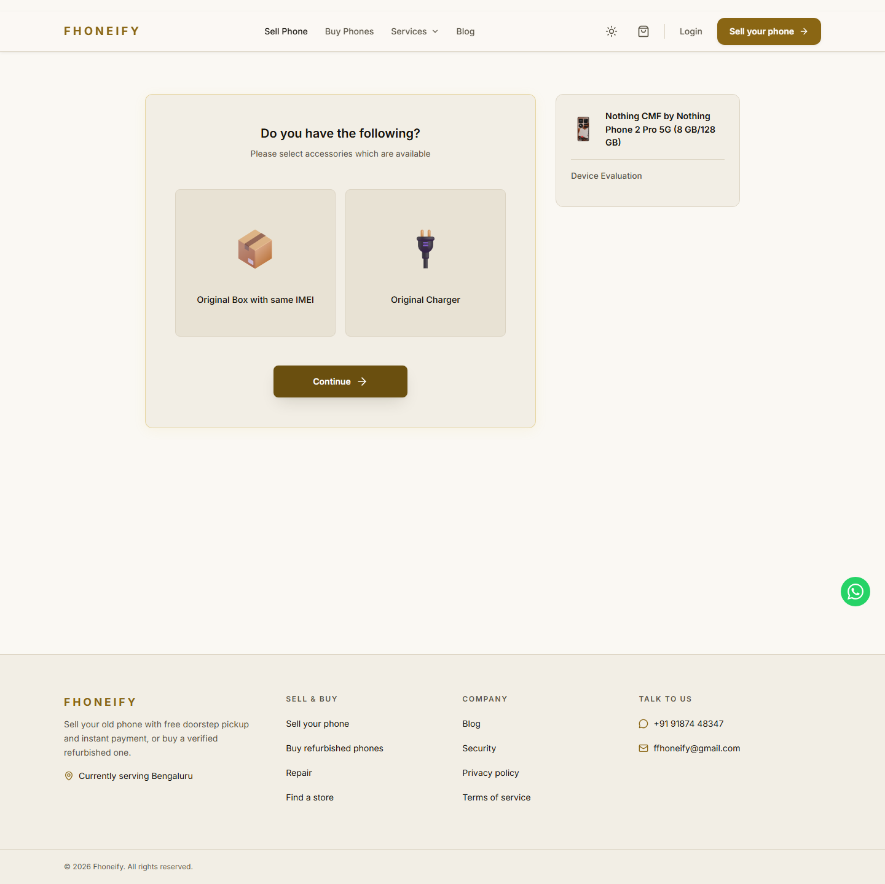
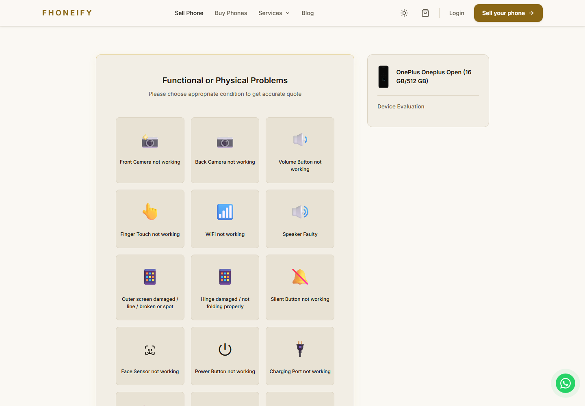

# Android runner pricing implementation and validation

Prepared 12 November 2026. This is an isolated review branch for the Nothing plan and its shared OnePlus companion, not a production release. No merge, deployment, reference refresh, production write, auth change or schema change was performed.

## Implementation

One importer and one pure repair model serve both brands. The current server reference remains authoritative; historic training references never replace it. Supported age/branch and repair costs are deducted, overlapping screen and panel repairs use their group maximum, age is charged once, and accessories use the observed combination. The existing reference-tier bonus (8/6/4%, capped at INR1,000), final-engine floor, fees, coupon allowance and signed-token design remain unchanged. Unknown models retain the original calculator. No recorded-answer/final-price cache was introduced.

## Intake and provenance

| Brand | Models/folders | Source variants | Quoted | Pending | Excluded | Mirrored members | Unique variant answer profiles |
|---|---:|---:|---:|---:|---:|---:|---:|
| Nothing/CMF | 13 | 34 | 1,671 | 0 | 0 | 52 | 1,535 |
| OnePlus | 53 | 115 | 5,539 | 28 | 0 | 212 | 5,083 |

The two outer archives are byte-distinct. The 66 inner ZIPs mirror four standalone files each; their 264 mirrored members are not extra observations. JSON, CSV, text result objects and checkpoint prices/fee arithmetic were cross-checked. All file hashes and source pointers remain in private inventories. Counted profiles normalize device/storage, faults, age, warranty, bill and accessories. Repeated controls are not independent fitting evidence; identical per-rule storage/value points are deduplicated before fitting.

Nothing observations are dated 8 November; OnePlus observations are dated 8–9 November. The 9RT 8/128 run contains 18 priced rows and 28 plan-only pending rows. Pending prices/times remain null and observed answer paths remain empty. Unavailable questions do not become measured zero deductions. Page snapshots/account names and diagnostic.json contents are excluded from normalized exports.

Raw archives, full normalized records, validation row exports and execution logs are gitignored and excluded from public branch history. The fitted parameters, synthetic regression tests and this handbook are portable without those files; corpus-dependent tests explicitly skip when private sources are absent.

## Measured and inferred support

Calibration covers 66 models. Each model's own storages determine fixed repairs and reference fractions; affine/capped forms are selected only where supported. By-storage rules store repair costs, never final quotes or historical references. Browser code imports only questionnaire metadata, not repair parameters or pricing execution.

Nothing has 360 fixed, 174 proportional and one byStorage rule. OnePlus has 1,633 fixed, 465 proportional, 18 affine, three capped and 25 byStorage rules. Affine/capped forms require at least three distinct storages. Supported single conditions use measured parameters; combinations, unseen capacities and inherited repairs remain inferred. This describes parameter support, not a claim that a generated quote was observed on Cashify.

Phone 3a Lite's storage-dependent touch loss is preserved by the fit. Phone 1 never asks warranty, bill or age. Other measured models preserve conditional age despite first-page crawler metadata saying NOT_ASKED. Supported human-readable age labels are normalized.

9RT's uncollected repairs and scrap rule inherit OnePlus 9R parameters with support zero and explicit lineage. Its 18 priced observations pass the replay gate. The 28 pending shapes and 46 shapes at its unobserved 12/256 capacity were exercised through the service at an explicitly synthetic reference. Their records remain inferred-not-observed; an all-healthy pending control may share measured baseline parameters without becoming an observed record.

## Accuracy and coverage

Replay traverses createPricingService in hybrid mode with injected read-only exact-variant references. It checks base-basis equivalents and one bonus from the original reference. It is regression against fitting data, not independent Cashify validation.

| Gate | Nothing/CMF | OnePlus | Required |
|---|---:|---:|---|
| Source rows priced through service | 1,671/1,671 | 5,539/5,539 | all |
| In-sample within INR20 | 100% | 100% | at least 99% |
| In-sample MAE | INR0.156 | INR0.421 | at most INR10 |
| In-sample errors above INR300 | 0 | 0 | zero |
| Storage holdout within INR20 | 99.88% | 95.01% | 97% / 95% |
| Storage holdout rows / MAE | 1,671 / INR1.24 | 5,228 / INR6.69 | reported |
| Catalog variants priced or explained through service | 34 | 116 | all |
| Synthetic reference stress quotes | 10,026 | 33,234 | ±10%, ±25%, ±50% |

Reference checks preserve fixed deductions, scale fractions and recalculate bonus. They are engineering scenarios, not proof that Cashify repair policy remains unchanged at future references. Pending catalog variants used controlled fixture references in validation and remain unpriced in production until actual references exist.

Storage holdouts exclude all representations and controls of the withheld storage from coefficient fitting. Rule forms and questionnaire structure were discovered using the full corpus, then frozen before training-only refits, including the fixed/percentage fallback form for byStorage rules. Every fallback coefficient is refitted from training observations only. These holdouts validate coefficients conditional on structural discovery, not independent rule discovery. Single-storage models cannot support storage holdout. No gate was widened and no difficult row was dropped.

| Error detail | Nothing/CMF | OnePlus |
|---|---:|---:|
| Replay overquotes / underquotes | 11 / 15 | 89 / 144 |
| Replay signed bias | INR−0.024 | INR−0.099 |
| Replay median / p90 / p95 | 0 / 0 / 0 | 0 / 0 / 0 |
| Worst replay over / under | +10 / −10 | +10 / −10 |
| Holdout overquotes / underquotes | 82 / 91 | 435 / 451 |
| Holdout signed bias | INR−0.054 | INR−0.388 |
| Holdout median / p90 / p95 | 0 / 10 / 10 | 0 / 10 / 20 |
| Holdout errors above INR20 / 100 / 300 / 1,000 | 2 / 2 / 0 / 0 | 261 / 67 / 10 / 0 |
| Worst holdout over / under | +210 / −210 | +930 / −930 |

Worst replay examples: Nothing Phone 1 screen scratches +INR10 and CMF Phone 1 proximity −INR10; OnePlus 10 Pro fingerprint +INR10 and cracked glass −INR10. The two Nothing holdout misses are Phone 3a Lite touch failure, opposite withheld capacities. The largest OnePlus holdout overquote is Nord 4 non-original screen (+INR400); the largest underquote is Nord touch failure (-INR910). Every miss and source pointer is retained in each private validation/summary.json storageMisses array and heldout.jsonl, rather than publishing a bulk quote corpus.

Leave-one-model-out is report-only and weak: Nothing scores 1,533 rows, 27.27% within INR20, MAE INR406.66, worst over/under +6,550/−3,040. OnePlus scores 4,998 rows, 37.23% within INR20, MAE INR784.77, worst +7,710/−10,540. This borrows a measured model within an empirical profile; it is a diagnostic transfer experiment, not an approved unknown-model production fallback. Nothing Phone 1 has no eligible donor. Nine OnePlus models have unidentifiable cohorts, listed in the private summary, including Open and 9RT.

## Routing, catalog and references

Covered models enter the runner before older OnePlus display candidates, bill overrides, accessory corrections or exact captures. Those paths do not reprice the new result. Their original code and fixtures remain available for unknown models and retrospective checks. Apple calibration and other brand tables are unchanged.

Three Nothing and ten OnePlus variants were added as pending, with exact-storage links and no invented fallback prices. Nothing's placeholder was removed and its CMF link typo corrected. Existing OnePlus 9RT 12/256 remains: it has a fresh exact database reference but no supplied condition data.

Read-only production audits found 27 matching fresh Nothing references, four older refresh-failed CMF references and three missing keys. OnePlus has 105 fresh references, one older refresh-failed reference and ten missing source keys; most fresh references match the session bases, with three small differences. Four OnePlus models lack stored questionnaire profiles. See the companion reference-audit documents for timestamps and coverage. The existing refresh identity verifier rejects four CMF headings; that incompatibility was reported and left untouched. No production references or questionnaire rows were changed.

See [review response](RUNNER_REVIEW_RESPONSE_2026_11_12.md) for the seven review findings, regression coverage and before/after holdout results. Explicit owner approval is required for the seed_devices.ts catalog changes and for bypassing the October OnePlus display and accessory release routes. Both approvals remain pending.

## Verification and review

Final post-review offline runner: **73 passed, 0 failed, 2 excluded**. All 23 focused review regressions pass. Both Next/server TypeScript projects pass with zero errors; strict typechecking of the changed tooling and regression suite also passes. Production build exits 0 with existing lint/configuration warnings. These checks ran after fix commit 3a257d0. Earlier UI guards and built-frontend browser evidence below predate this follow-up; browser verification was not rerun for these fixes.

The runner excludes the production-writing integration suite and browser-only suite. Browser verification runs separately. Corpus-dependent suites skip explicitly when private data is absent. Catalog properties still report 2,082 pre-existing known-policy no-calls exceptions on other brands; the invariant and classification remain unchanged.

October candidate and golden fixtures explicitly exercise the preserved historical calculator through an internal evaluation dependency. No historical golden price was rewritten. This opt-out is absent from server configuration and cannot be selected through public diagnostics. Current behavior is tested by source replay, current service tests and catalog properties. The property suite uses measured question eligibility and checks loose/bent alternatives against clean because their forced-age branches do not establish a total ordering at an already-old age. All true added-fault checks remain.

The separate review found inherited deductions could receive an overall measured label and human-readable age labels could lose depreciation. Both have failing-then-passing regressions. Additional regressions protect inferred-storage charger metadata, overlapping panel repairs, calls-combination support and deduction-basis breakdown reconciliation.

## Local browser evidence

The real Next frontend and production price controller/service were exercised with injected read-only reference fixtures and an unreachable database. Get Upto matches the API and survives reload. Real initial selections reach conditional age. Phone 1 shows three initial questions. Charger visibility was checked on CMF 2 Pro, Phone 1 and two Phone 4a capacities. Open shows hinge and outer-screen choices. No page errors were observed. Direct step URLs were also used for option-visibility checks.

These are local Fhoneify QA screenshots, not Cashify captures or live-production evidence. Signed quote and lead-price agreement were checked at service level. Real OTP delivery, authenticated browser lead submission, persisted database lead/reload, deployed revisions and live production quotes were not verified. No unnecessary production lead was created.

## Combination evidence and remaining work

Prepared 75 Nothing and 77 OnePlus planned combinations, including the cheap-phone display cap probe and the exact OnePlus 12 five-functional-fault floor probe. Its INR1,200 scrap outcome is inferred, with no combination evidence. The collection documents record frozen calibration and implementation hashes. Frozen private predictions and snapshots are under release-test-logs/android/frozen-combinations-v3-final; the earlier snapshot is preserved. The team must collect actual combinations and score them at the newly observed reference against frozen rules before refitting. No combination has been promoted to measured.

Material limits remain: missing/stale production references, inherited 9RT repairs, unseen-storage errors up to INR910 in OnePlus holdout, weak transfer to unseen models and unobserved multi-fault interactions. Passing these gates does not establish universal Cashify parity or years of unchanged repair costs.

## Delivery and rollback

The Android branch started on Phase 0 commit 0a683cd (PR31), following the instruction to continue without waiting. Before delivery, remote main and PR31 were verified to include that same commit; PR31 was merged externally on 11 November at 05:31:27 UTC. This agent did not perform that merge. The Android PR therefore targets current main and contains only Android commits. Both original work-order documents are included for review. Unrelated worktrees were preserved. The documented recommended inference strategy is implemented for review; this is not separate production-policy approval.

No merge or deployment is authorized. Release requires the owner's instruction and handling the operational reference gaps and applicable live checks. Rollback reverts the Android commits as a group while retaining the approved INR1,000 bonus-cap repair. Preserve bonus policy, auth, schema and refresh during rollback. The retrospective dependency is an evaluation mechanism, not a production rollout flag.

## Per-model replay appendix

### Nothing

| Model | Priced rows | MAE INR | Within INR20 |
|---|---:|---:|---:|
| CMF by Nothing Phone 1 | 98 | 0.102 | 100.00% |
| CMF by Nothing Phone 2 Pro 5G | 102 | 0.000 | 100.00% |
| Nothing Phone 1 | 138 | 0.145 | 100.00% |
| Nothing Phone 2 | 147 | 0.340 | 100.00% |
| Nothing Phone 2a 5G | 147 | 0.340 | 100.00% |
| Nothing Phone 2a Plus | 98 | 0.714 | 100.00% |
| Nothing Phone 3 | 102 | 0.294 | 100.00% |
| Nothing Phone 3a | 98 | 0.000 | 100.00% |
| Nothing Phone 3a Lite | 102 | 0.196 | 100.00% |
| Nothing Phone 3a Pro | 147 | 0.000 | 100.00% |
| Nothing Phone 4a | 198 | 0.000 | 100.00% |
| Nothing Phone 4a Pro | 147 | 0.068 | 100.00% |
| Nothing Phone 4b | 147 | 0.000 | 100.00% |

### OnePlus

| Model | Priced rows | MAE INR | Within INR20 |
|---|---:|---:|---:|
| OnePlus 10 Pro 5G | 92 | 0.870 | 100.00% |
| OnePlus 10R 5G | 92 | 0.652 | 100.00% |
| OnePlus 10T 5G | 138 | 0.362 | 100.00% |
| OnePlus 11 5G | 102 | 0.392 | 100.00% |
| OnePlus 11 5G Marble Edition | 51 | 0.000 | 100.00% |
| OnePlus 11R 5G | 153 | 0.458 | 100.00% |
| OnePlus 12 | 102 | 0.294 | 100.00% |
| OnePlus 12R | 153 | 0.065 | 100.00% |
| OnePlus 13 | 153 | 0.065 | 100.00% |
| OnePlus 13R | 102 | 0.882 | 100.00% |
| OnePlus 13s | 153 | 0.000 | 100.00% |
| OnePlus 15 | 102 | 0.000 | 100.00% |
| OnePlus 15R | 102 | 0.000 | 100.00% |
| OnePlus 3 | 46 | 0.000 | 100.00% |
| OnePlus 3T | 92 | 0.978 | 100.00% |
| OnePlus 5 | 92 | 0.652 | 100.00% |
| OnePlus 5T | 92 | 0.870 | 100.00% |
| OnePlus 6 | 138 | 1.159 | 100.00% |
| OnePlus 6T | 138 | 0.942 | 100.00% |
| OnePlus 6T McLaren | 46 | 0.000 | 100.00% |
| OnePlus 7 | 92 | 0.217 | 100.00% |
| OnePlus 7 Pro | 138 | 0.580 | 100.00% |
| OnePlus 7T | 92 | 1.196 | 100.00% |
| OnePlus 7T Pro | 92 | 1.522 | 100.00% |
| OnePlus 7T Pro McLaren Edition | 46 | 0.000 | 100.00% |
| OnePlus 8 | 138 | 0.580 | 100.00% |
| OnePlus 8 Pro | 92 | 0.326 | 100.00% |
| OnePlus 8T | 92 | 1.087 | 100.00% |
| OnePlus 9 5G | 92 | 0.217 | 100.00% |
| OnePlus 9 Pro 5G | 92 | 0.217 | 100.00% |
| OnePlus 9R 5G | 92 | 0.217 | 100.00% |
| OnePlus 9RT 5G | 18 | 0.000 | 100.00% |
| OnePlus N6 | 102 | 0.294 | 100.00% |
| OnePlus N6 Lite | 51 | 0.000 | 100.00% |
| OnePlus N6x | 102 | 0.000 | 100.00% |
| OnePlus Nord | 138 | 0.072 | 100.00% |
| OnePlus Nord 2 5G | 138 | 0.145 | 100.00% |
| OnePlus Nord 2T 5G | 92 | 0.109 | 100.00% |
| OnePlus Nord 3 5G | 102 | 1.373 | 100.00% |
| OnePlus Nord 4 | 153 | 0.392 | 100.00% |
| OnePlus Nord 5 | 153 | 0.065 | 100.00% |
| OnePlus Nord 6 5G | 102 | 0.000 | 100.00% |
| OnePlus Nord CE 2 5G | 92 | 0.652 | 100.00% |
| OnePlus Nord CE 2 Lite 5G | 92 | 0.652 | 100.00% |
| OnePlus Nord CE 3 5G | 102 | 0.294 | 100.00% |
| OnePlus Nord CE 3 Lite 5G | 102 | 0.882 | 100.00% |
| OnePlus Nord CE4 5G | 102 | 0.490 | 100.00% |
| OnePlus Nord CE4 Lite 5G | 102 | 0.686 | 100.00% |
| OnePlus Nord CE 5 | 153 | 0.000 | 100.00% |
| OnePlus Nord CE 5G | 138 | 0.507 | 100.00% |
| OnePlus Nord CE 6 5G | 102 | 0.000 | 100.00% |
| OnePlus Nord CE 6 Lite 5G | 153 | 0.261 | 100.00% |
| OnePlus Open | 53 | 0.000 | 100.00% |

## Reproduction commands

Run the portable offline suite runner documented in the handbook, both TypeScript projects and npm run build with safe local/unreachable database settings. Import each supplied folder with import-cashify-runner-data.ts <folder> --brand Nothing|OnePlus --out <private-directory>. Fit using fit-cashify-runner-calibration.ts --brand=Nothing|OnePlus --write; writing refuses absent private observations. validate-cashify-runner.ts Nothing|OnePlus writes the private complete error exports.

Local browser QA: runner-browser-api.ts uses only injected private fixture references and unreachable DB, exposes only POST /api/quote/price on port 5310, and exposes no auth/lead endpoints. Build with NEXT_PUBLIC_API_URL=http://127.0.0.1:5310, serve Next on 3310, then run verify-runner-browser.cjs. Never point this QA helper at production or use it as the deployed API.
