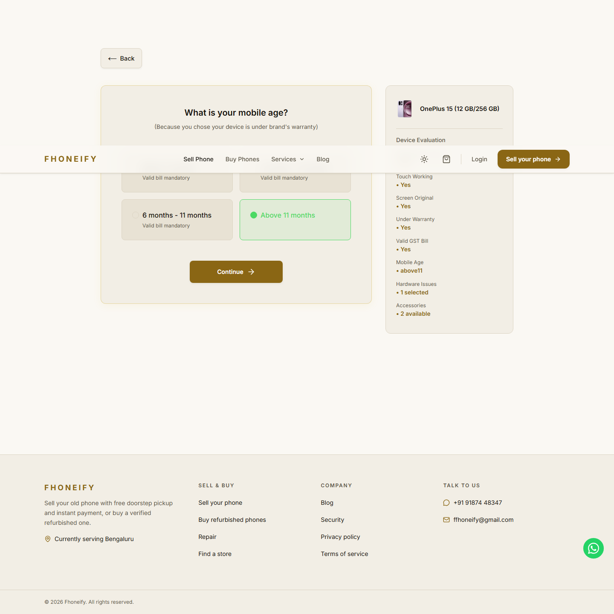
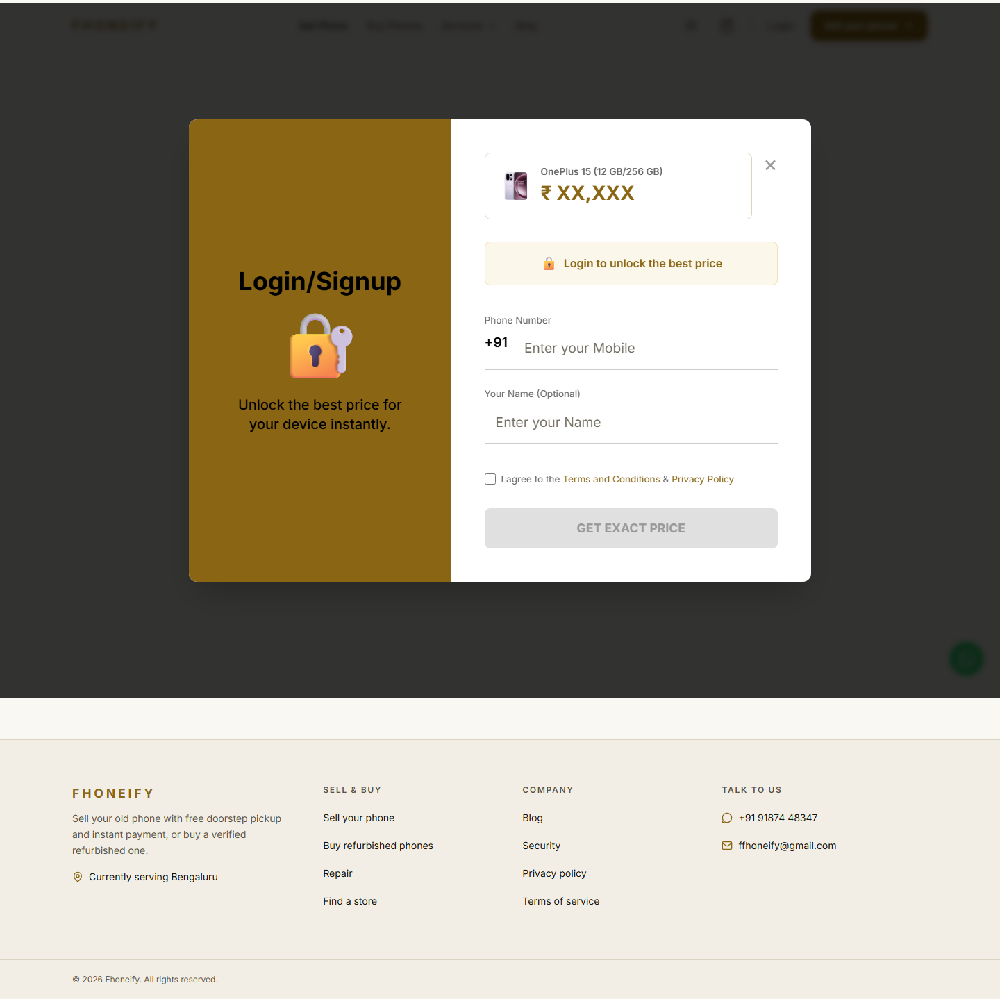

# Runner review response, 12 November 2026

This responds to all seven items in RUNNER_REVIEW_2026_11_12.md. The review branch was pulled into the isolated Android branch. Existing draft PR #32 stays a draft; no merge or deployment is authorized.

1. Unsupported hardware, unknown physical labels, missing defect-group details and missing model rules now throw InspectionRequiredError. The service returns MANUAL_INSPECTION_REQUIRED without a price or signed token. Physical labels normalize case, repeated whitespace and spacing around slashes. Regressions cover hinge, s_pen, arbitrary hardware, broken_screen without details, other incomplete/unknown groups and all three cracked-label variants.
2. Missing age refuses a quote when the profile asks age and the condition still reaches that question. Severe display/panel/bent faults, warranty No and bill No preserve the measured forced-age branch; calls No preserves its scrap branch. Loose screen still requires age. Profiles without an age question remain unaffected. Direct and service regressions cover these paths.
3. Affine/capped fitting requires at least three distinct storages, including during conditional holdout refits. Two-storage rules use fixed/percentage where residual is at most INR10, otherwise measured byStorage repair amounts plus a simple fixed/percentage fallback. Conditional holdout freezes the discovered fallback form as well as the primary form, refitting every coefficient from training rows only; full-corpus form discovery remains an explicit limitation. Tests cover two storages, duplicate storage observations, frozen affine/capped shapes and training-only fallback coefficients.

   Replay remains 1,671 Nothing and 5,539 OnePlus quotes, all within INR10. Nothing storage holdout remains 99.8803% within INR20; MAE improves from INR1.3106 to INR1.2448. OnePlus changes from 97.1882% / MAE INR9.5964 to 95.0077% / MAE INR6.6890 across the same 5,228 rows: -2.1805 percentage points and -INR2.9074 MAE. OnePlus misses above INR20 increase 147 to 261; above INR300 decrease 53 to 10. No gate was widened and no row was removed. The 95% gate passes narrowly. These are conditional coefficient holdouts, not independent form discovery.

4. Explicit owner approval is required for the seed_devices.ts catalog changes. Explicit owner approval is also required for bypassing the October OnePlus display and accessory release routes on covered models. Implementation and passing tests do not grant either policy approval. These decisions must be disclosed in PR #32 and remain pending before merge or deployment.
5. OnePlus 12 12 GB/256 GB with Wi-Fi, Bluetooth, fingerprint, face and back camera failures reaches the INR1,200 scrap floor at R=INR33,470. This is inferred additive behavior, with no combination evidence. The exact FLOOR01 probe is in the OnePlus collection document and frozen predictions. A regression checks the price and inferred support. Collection version 3-final has 75 Nothing and 77 OnePlus plans; previous frozen snapshots are preserved. No observations were promoted.
6. Explicit box:false and charger:false override stale accessories entries. Separate regressions compare each conflict with the corresponding genuinely absent accessory. Collection generation now keeps explicit accessory flags consistent with changed arrays.
7. Final verification results are recorded below after committing the fixes. The portable offline runner excludes the production-writing integration suite and browser-only suite. It forces an unreachable local database; no production test rows are created.

Verification after fix commit 3a257d0: **73 offline suites passed, 0 failed, 2 excluded**. The new review suite contains **23 passing tests**, including the inherited __proto__/constructor defect-ID bypass found during independent review. Both TypeScript projects report **0 errors**. The strict changed-tool/test typecheck passes. **npm run build exits 0** with existing lint/configuration warnings.

Commands: node --import tsx scripts/pricing-evidence/run-offline-suites.ts --logs=release-test-logs/runner-review/final-offline; tsc --noEmit -p tsconfig.next.json; tsc --noEmit -p tsconfig.server.json; npm run build. Private final logs are under release-test-logs/runner-review. The two explicit exclusions are pricing.quote-integration.test.ts (production-writing integration) and pricing.agent-z-browser.test.ts (browser-dependent). Browser tests were not rerun in this follow-up. No main merge or deployment was performed.

The stricter runner validation also exposed explanation probes that temporarily select a defect group without details. The explanation now catches only typed inspection refusals for those isolated probes, never classifies them as ignored, and still propagates refusals for a complete group/final input. Catalog parity tests compare refusal reasons as well as prices; the quote persistence test now supplies its actual storage to the expected engine call. No historical golden amount was changed.

## Finding 8 follow-up

Pulled the subsequent review update from origin/claude/nothing-phone-perfection-4c176d. Percentage-backed byStorage rules now retain each measured value's reference and evaluate deduction = measured deduction * current reference / measured reference. The current server reference remains authoritative; the anchor normalizes a deduction and never replaces that current reference or stores a final quote. Fixed-backed rules remain fixed, including the two fixed-backed age rules identified in the review. No new age percentage was invented. The specified percentage-backed repair/age behavior applies to all such rules: Nothing 1 rule / 2 storage values; OnePlus 17 rules / 35 storage values. Nine OnePlus age rules are among those corrected.

The fitter emits anchors only from supplied training observations. A missing or invalid percentage normalization anchor requires inspection; unseen storage still uses the training-derived fallback. Independent code review found no critical/important issue or new numerical holdout leakage. Existing primary/fallback form discovery remains conditional on the full corpus, as disclosed above.

Three new reference-move tests pass. OnePlus 15 12/256 above-11 loss is INR12,980 at its measured INR57,250 reference, INR11,682 at -10% and INR14,278 at +10%. Warranty No, bill No, cracked glass, panel, bent, touch No and non-original screen all use the same scaled age rule. Tests also cover training-only anchors, unseen/fixed behavior and invalid anchors. Engine revision is cashify-runner-rules-v3.

Verification rerun:

| Check | Result |
|---|---|
| Nothing service replay | 1,671/1,671 within INR10; MAE INR0.1556 |
| OnePlus service replay | 5,539/5,539 within INR10; MAE INR0.4207 |
| Nothing storage holdout | 1,671 rows; 99.8803% within INR20; MAE INR1.2448 |
| OnePlus storage holdout | 5,228 rows; 95.0077% within INR20; MAE INR6.6890 |
| Full offline runner | 74 passed, 0 failed, 2 excluded |
| New reference-move regressions | 3 passed, 0 failed |
| Next/server TypeScript and strict changed tooling/test checks | 0 errors |
| Local production build | Exit 0; existing warnings |

Replay and storage-holdout metrics are unchanged by this correction. No source row was dropped and no gate changed. Private logs: release-test-logs/runner-review-8. Updated frozen collection version 4 retains 75 Nothing and 77 OnePlus plans; previous snapshots are preserved.

Browser verification uses the built local Next frontend and production quote controller/service with injected read-only references and an unreachable database. Nothing Phone 3a 8/128 and OnePlus 15 12/256 both retain the exact API Get Upto after reload, reach conditional age through actual selections, preserve above11 and Wi-Fi failure after reload, submit those exact persisted UI answers to the public quote API successfully, and reach the normal Login/Signup boundary. Get Upto is INR21,200 / INR58,250; the separately checked quote API returns INR10,240 / INR28,090 for those selected answers. API responses identify runner revision v3. Phone 1's three initial questions, four charger-visibility variants and Open's fold options also pass. No browser page errors.

The quote API check is separate from the gated final-price screen. No authenticated final screen, OTP delivery, lead creation, database lead persistence or deployed revision was tested. No authentication/session bypass was added. Screenshot evidence is local Fhoneify QA, not live or Cashify evidence:

Explicit owner approvals for catalog changes and the October-route bypass remain pending. No merge into main or deployment was performed.
