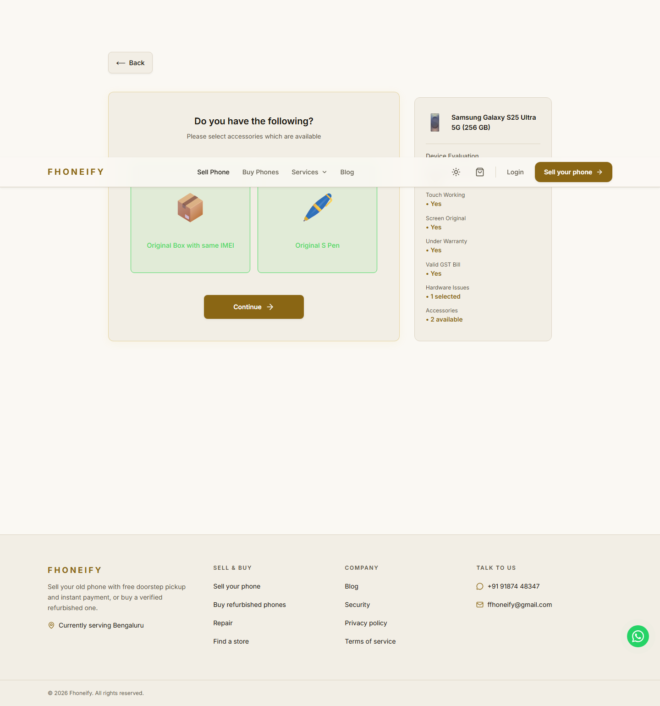
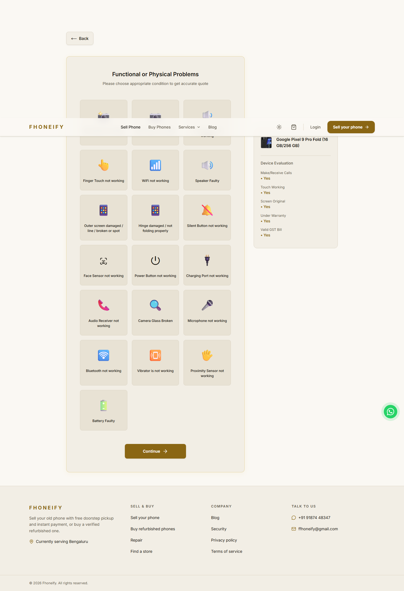

# Samsung and Pixel implementation review — 13 November 2026

**Draft, not release-ready. Samsung storage holdout is 93.04% within INR20, below the required 95%.** The gate remains unchanged. Nothing has been merged or deployed by this work. Owner approval for catalog additions, inferred incomplete answers and replacement of October Samsung routes remains pending.

The branch starts at main `8bcf2fd`, which already contains the Nothing/OnePlus release. It implements [SAMSUNG_PIXEL_CODEX_PLAN.md](SAMSUNG_PIXEL_CODEX_PLAN.md) using the existing `cashifyRunnerModel`. This report separates working implementation and regression checks from the failed empirical acceptance gate.

## Intake and source accounting

| Source | Priced observations | Pending | Measured no-offer | Not applicable |
|---|---:|---:|---:|---:|
| Samsung A: runner | 16,785 | 266 | 29 | 0 |
| Samsung B: JSON-backed reports/checkpoint | 1,063 | 0 | 1 | 0 |
| Samsung C: text reports | 2,449 | 70 | 10 | 188 |
| Samsung total | 20,297 | 336 | 40 | 188 |
| Google runner | 1,536 | 0 | 0 | 0 |

Samsung has 182 runner folders and 33 report ZIP entries. The byte-identical Flip ZIP copy is counted once. The runner files contain 362 variant records with rows, representing 358 unique variants; there is also one declared M42 8/128 variant with no results or plan. It is recorded as empty rather than inventing pending observations or a baseline. Across all formats there are 414 source variants. Google has 22 folders, 22 models and 32 variants. Inner runner ZIP mirrors are cross-checked, not additional observations: 728 Samsung and 88 Google mirrored members.

Source hashes cover every outer member and each nested report member. Windows metadata is explicitly ignored. `diagnostic.json` content is never copied into normalized observations or public output. Long paths are handled inside ZIPs and short numbered private staging folders. Supplied code is never executed.

Runner JSON/CSV/text/checkpoint values are reconciled. Format B labels and answers come from the complete text cases or the explicit canonical questionnaire; unlabeled monetary-array positions are not guessed into labels. Their monetary multisets are cross-checked against text. Original case IDs, report line, observation date and source hash remain private. Unknown selected labels and incomplete initial answers fail import. Answers are bounded to their own question, so a missing calls answer cannot borrow the following touch answer. Unverified cases remain pending with unknown answers and null prices/timestamps; no-offer is a measured refusal, never zero.

There are 339 Selling-only text observations. Their Base normalization uses the report's explicit INR20 IMEI-fee statement; absent per-case fees and totals remain null. This is a disclosed derivation, not a claim that a full receipt was observed for every case.

## Primary observations and source differences

The importer retains old and duplicate observations but selects one source session per variant by observation date, then deduplicates semantically identical answer profiles within it. Repeated clean controls are not independent fitting evidence. Primary priced profiles are **17,674 Samsung** and **1,408 Google**; the full raw counts above remain distinct.

The four October Fold tables are retained for drift comparison and excluded from fitting. Newer S25 and S25 Ultra runner sessions replace their older partial text sessions. The same-day S26 Ultra reports cannot be ordered by available observation timestamps: the JSON-backed report is selected consistently for the entire variant rather than mixing its S Pen questionnaire and reference with the Selling-only report. This tie-break is an explicit judgment, not evidence of a later observation time.

Private source comparisons retain 25 overlapping variant/source pairs. Reference differences range from zero to INR2,000; six pairs differ in offered accessories. After matching exact normalized answer profiles, no additional conflicting quoted Base values were found; differing questionnaires are not asserted to be identical inputs. All comparison records and both original sources remain private under `release-test-logs/samsung-pixel/source-drift.json` and the imported summary/inventory. Reports' broad introductory descriptions do not override their explicit per-case answers.

The actual complete Pixel 10/11 Fold schemas omit hinge/outer-screen cases; Pixel 9 Pro Fold contains them. The UI follows that observed distinction instead of inventing questions or zero-cost repairs from the work-order's broader statement. Unsupported API answers require inspection.

## Fitting and inference

Samsung calibration covers **205 models / 8,314 rules**; Google covers **22 models / 895 rules**. The simplest supported fixed/percentage rule is used first. Affine/capped rules require at least three distinct storages, including refits. Percentage-backed by-storage repair values scale from their measured normalization reference to the current server reference; historical references never replace the current lookup. Complex forms record a simple fallback form for conditional refits; its coefficient is learned from training observations only.

Samsung forms: 6,932 fixed, 1,150 percentage, 161 by-storage, 7 capped and 64 affine. Google: 818 fixed, 72 percentage, 2 by-storage and 3 affine. Samsung has 96 inherited repair rules, all marked with zero measured support and explicit same-series donor lineage. Google has no inherited rules. Inference is restricted to incomplete Samsung models; S Ultra, Fold, Flip, Note and letter series remain separate, and brands are never crossed.

No-offer rules are model/answer/storage specific. The measured all-accessories-missing deduction is used, including S Pen models; two missing accessories out of three are inferred and their max-rule breakdown includes an overlap credit. Face-zero measurements remain zero. The calls-only scrap observation is retained independently: where measured condition quotes are lower, its universal clamp is disabled for that new storage rather than storing an observed final quote as a new floor. Measured faded-edge/discoloration combinations use repair-group parameters, including cases that would refuse the isolated discoloration answer. These extensions are absent from existing-brand profiles.

## Authoritative service gates

| Check | Samsung | Google | Required |
|---|---:|---:|---|
| Primary priced profiles through actual service | 17,674 / 17,674 | 1,408 / 1,408 | all |
| Within INR20 | 100% | 100% | 100% |
| Replay MAE | INR0.538 | INR0.227 | report |
| Replay errors above INR300 | 0 | 0 | 0 |
| No-offer manual inspection | 40 / 40 | none observed | all, including 29 / 29 runner refusals |
| Storage holdout rows | 15,552 | 829 | report |
| Storage holdout within INR20 | **93.0427% — FAIL** | **95.6574% — PASS** | at least 95% each |
| Numeric holdout MAE | INR22.166 | INR3.619 | report |
| Holdout inspection refusals | 8 | 0 | count as misses |
| Numeric holdout misses above INR20 | 1,074 | 36 | report |
| Holdout misses above INR300 | 361 | 2 | list privately |
| Worst numeric holdout over / under | +2,250 / -1,530 | +400 / -400 | report |

Samsung primary replay by source format: **A 15,241; B 977; C 1,456**, each 100% within INR20. Their MAEs are INR0.585, INR0.420 and INR0.117. In-sample replay is a regression against fitting observations, not independent validation or proof of future Cashify parity.

Holdout removes every observation/control of the withheld storage from coefficient and normalization-anchor fitting. Same-series independent donor rows remain available for the already-approved incomplete-model inference strategy. Primary and fallback forms are frozen after full-corpus structural discovery; this is conditional coefficient validation, not independent form discovery. Refusals remain in the denominator. MAE is over numeric predictions only. No threshold was widened, withheld price copied, or difficult row dropped.

Every miss above INR300 is retained with model, storage, original answer/case and source pointer in each private `data/pricing-evidence/<brand-date>/validation/summary.json` `over300` array, and every numeric held-out row in `heldout.jsonl`. Full quote-derived error exports remain private under repository rules. Samsung's failed gate is a release blocker, not a waived warning; more evidence or a separately reviewed model change is needed.

## Catalog, references and routing

The canonical runner identity combines Samsung's separate catalog RAM and storage fields. The S25 Ultra test proves catalog `256 GB` plus RAM `12 GB` reaches the measured `12gb/256gb` profile, not an inferred storage fallback. Existing repository reference keys and the frontend's selected catalog identity stay unchanged.

The branch adds **99 Samsung and 6 Google variants as pending**, with no invented Base prices. Samsung now has 432 catalog records, Google 32. Sixteen Samsung catalog records have no supplied data and retain the existing fallback or their model's explicitly inferred storage behavior; all source-backed identities are mapped. Pending catalog additions do not create reference rows.

Production audit at **2026-11-13 16:05:50 UTC** ran only reference/profile selects in a verified read-only transaction (`transaction_read_only=on`). The connected Supabase account exposed an unrelated project; the fallback used the existing Fhoneify configuration without printing credentials. No refresh, schema change or production write occurred.

| Audit | Samsung | Google |
|---|---:|---:|
| Existing production reference rows | 333 | 26 |
| FRESH / MISSING / REFRESH_FAILED | 301 / 31 / 1 | 26 / 0 / 0 |
| Source variants without a reference key | 99 | 6 |
| Existing questionnaire profiles | 149 | 19 |
| Source model names without a profile | 60 | 3 |

Full per-variant audit and matching details remain in `release-test-logs/samsung-pixel/reference-audit.json` and `reference-summary.json`. Missing/stale references are operational release gaps; source baselines were never substituted into production.

Covered Samsung models enter the runner before the unchanged `calculateSamsungPrice` body. Google enters the shared runner and falls back to the existing generic calculator on null. The authoritative service skips old October exact/candidate/accessory repricing for covered models, so bonus is applied once from the original reference. Historical Samsung release-route, workbook and calibration fixtures explicitly use the existing retrospective dependency. No golden amount was rewritten. The separate workbook research service remains a research tool, not the customer quote route.

Nothing, OnePlus and Apple calibration files are unchanged. A portable fingerprint captured from main before this work verifies **22,932 synthetic other-brand price scenarios** unchanged. Engine version advances once to `cashify-runner-rules-v4`; signature design, bonus tiers/cap/floor, fees, authentication, schema and Cashify refresh are unchanged.

## Verification and local browser evidence

Final reviewed verification: **79 offline suites passed, zero failed, two excluded**; both Next.js and server TypeScript projects passed with zero errors; strict tooling TypeScript checks passed; `npm run build` passed. The two exclusions remain the production-writing integration suite and browser-dependent suite. A separate fresh browser run passed all five flows after the review fixes. Corpus acceptance is a separate command, and Samsung's failed acceptance remains visible even though code regression suites pass.

Five real built-frontend flows use the production price controller/service with injected read-only references and an unreachable database: Samsung A35 8/128, S25 Ultra catalog 256 GB, Fold6 12/256, Pixel 11 12/256 and Pixel 9 Pro Fold 16/256. Get Upto matches the API and survives reload; actual initial selections reach functional/accessory and conditional age screens; selected age persists after reload; the exact UI answers receive a signed quote through the public endpoint; each reaches the ordinary Login/Signup boundary. S Pen is offered on the measured S25 Ultra route, not as an invented hardware fault. Fold6 and Pixel 9 Fold expose outer-screen and hinge choices. No page errors were observed.

These checks stop before authentication. OTP delivery, the authenticated final-price screen, real lead submission, database lead persistence, production URLs and deployed revisions were not verified. No auth/session bypass was added and no lead was created. Screenshots are local Fhoneify QA, not Cashify screenshots or live-production evidence.

Independent review found a missing-answer parser weakness and an inferred-accessory provenance/breakdown error. Both received failing-then-passing regressions. Historical severity tests compare mutually exclusive display alternatives to clean where their ordering at already-old ages is unmeasured; all separate added-fault checks remain. This is not evidence that uncollected age/display combinations match Cashify.

## Collection, owner decisions and rollback

Implementation judgments and their limits:

| Judgment | Cost if the assumption is wrong |
|---|---|
| Normalize Selling-only reports using their explicit INR20 IMEI statement; keep absent receipt fields null. | A changing fee requires remeasurement. |
| Select the same-date JSON-backed S26 Ultra session as a whole variant. | A newer text session needs timestamps or recollection before superseding it. |
| Disable the universal calls-scrap clamp where lower condition quotes were measured; use measured screen groups. | Unseen combinations remain inferred and need collection. |
| Follow the observed Pixel 10/11 Fold schemas without hinge/outer-screen questions. | If collection missed a question, those models need recollection. |
| Preserve the failed Samsung holdout gate. | This draft remains blocked pending more evidence or a reviewed model change. |
| Keep October fixtures on the explicit retrospective dependency and check current routes separately. | Historical tests alone cannot prove the current route; the separate service replay is essential. |
| Compare mutually exclusive display alternatives to clean at already-old ages while retaining added-fault checks. | Their unmeasured relative ordering and age interactions need collection. |

The [Samsung](../next-quotes/samsung-combinations.md) and [Google](../next-quotes/google-combinations.md) documents contain **125 planned combinations**: 75 Samsung, 50 Google. Five charger-only plans are explicitly not applicable. Current model/calibration snapshots and predicted outcomes are frozen privately under `release-test-logs/samsung-pixel/frozen-combinations-v2`; the earlier snapshot is preserved. Collect controls and actual answer paths, score at the newly observed reference against those frozen parameters, and only then refit. No plan was promoted to an observation.

Before release, the owner must explicitly approve the pending catalog additions, same-series inferred answers on incomplete models, and replacement of the October Samsung customer-pricing routes. Samsung must also meet its unchanged empirical acceptance gate. Passing source replay or a build is insufficient. Keep the PR in draft; do not merge or deploy without the owner's instruction.

Rollback reverts this branch's Samsung/Google code, parameters, catalog additions and questionnaire wiring while retaining the existing Nothing/OnePlus/iPhone release and INR1,000 bonus cap. No database migration or production data rollback is required because none was performed.

## Reproduction

Use the safe environment and suite runner in the handbook. Import each owner archive with `import-cashify-runner-data.ts <zip> --brand Samsung|Google --out <private-directory>`. Fit with `fit-cashify-runner-calibration.ts --brand=Samsung|Google --write`; absent evidence refuses writes. Run `validate-samsung-pixel.ts Samsung` and `Google` with unreachable database URLs: Samsung currently exits nonzero for the holdout gate. Run the full offline runner, both `tsc` projects and `npm run build`. Browser helpers use local ports 5311/3311 and expose no auth or lead endpoints. Private evidence is required to reproduce corpus-dependent gates; code regression and protected-price tests are portable.
