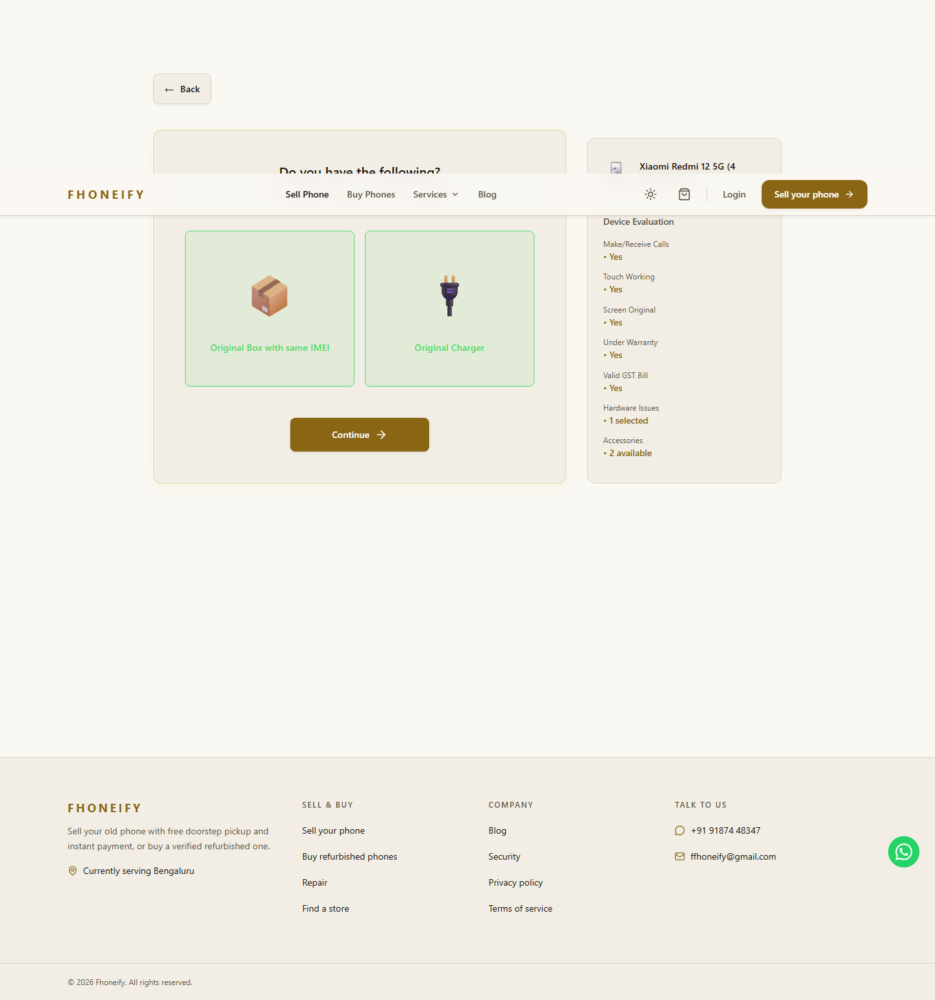
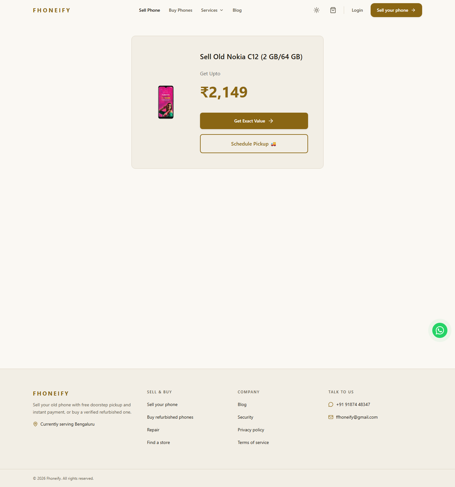

# Xiaomi and other-brand implementation review - November 2026

**Draft for review; not merged or deployed. Honor storage holdout is 94.61% and Asus is 86.67%, below the unchanged 95% gate.** The affected inferred catalog coverage and the limits of those error estimates are listed below. No release approval is implied.

Implements [XIAOMI_OTHERS_CODEX_PLAN.md](XIAOMI_OTHERS_CODEX_PLAN.md) from plan branch `claude/xiaomi-others-plan` (`d01108a`), which includes main `b027422`. The owner already approved section 2: pending catalog additions, labelled same-series inference, replacing October Xiaomi routes for covered models, and dated text-only Xiaomi evidence. POCO, Realme and other untested brands retain their pricing. The sole permitted correction to a previously released shared profile is OnePlus 9RT.

## Intake

| Source | Variants | Priced | Pending | No-offer | Not applicable |
|---|---:|---:|---:|---:|---:|
| Xiaomi all formats | 272 | 14129 | 315 | 0 | 120 |
| Honor  | 26 | 1136 | 74 | 1 | 0 |
| Asus  | 6 | 275 | 0 | 1 | 0 |
| Lenovo  | 6 | 264 | 0 | 12 | 0 |
| Nokia  | 54 | 2447 | 43 | 9 | 0 |
| OnePlus  | 2 | 92 | 0 | 0 | 0 |
| Google  | 2 | 98 | 0 | 0 | 0 |

Xiaomi runner alone is **84 folders / 188 variants / 8,776 priced**. Honor is 16 folders, Asus 3, Lenovo 5, Nokia 32, 9RT 1 and Pixel gap-fill 2. Xiaomi contains 50 top-level report ZIP entries and six nested ZIP entries under `Partial/`; five byte-identical archive duplicates are counted once, leaving **51 unique report ZIPs**. All yield priced text cases, including Redmi A2, Note 13 Pro and Note 13 Pro Plus; their side-file monetary multisets are checked using explicit variant maps. No report is called imported merely from its filename.

Runner JSON, CSV, text and checkpoint amounts agree, including fee arithmetic and final controls. Mirrored inner ZIP members are cross-checked and not additional observations. Archives and source members are hashed; original case IDs, source lines and dates remain in private observations. Nested ZIPs are read in memory; supplied code is never executed. `diagnostic.json` and `.running.lock` contents are ignored. All raw archives, normalized rows and bulk audits remain gitignored and absent from public history.

Unverified lines remain pending with null prices and unknown diagnostics. No-offer, not-applicable and not-asked remain distinct. One primary session is chosen for each variant; complete Xiaomi sessions take precedence, then newest observation date, with deterministic same-day ties. Duplicate answer profiles stay together. Incomplete-only models retain their measured cases and use explicitly inferred missing rules.

Xiaomi has 113 disagreements against the primary session, retained privately with both source pointers. These are source drift, not extra fitting rows. Older report deductions are fitted against their own day's flawless Base; historical baselines never replace the current server reference. Fixed repairs remain fixed and percentage rules follow the current reference.

### Text-report counts per unique archive

| Archive | Priced | Pending | No-offer | Not applicable |
|---|---:|---:|---:|---:|
| Cashify_Redmi_12_5G_All_Variants_All_Test_Cases.zip | 171 | 0 | 0 | 9 |
| Cashify_Redmi_12_5G_All_Variants_Verified_Cases_PARTIAL.zip | 81 | 90 | 0 | 9 |
| Cashify_Redmi_12_All_Variants_All_Test_Cases.zip | 114 | 0 | 0 | 6 |
| Cashify_Redmi_12_All_Variants_Verified_Cases_PARTIAL.zip | 54 | 60 | 0 | 6 |
| Cashify_Redmi_12C_All_Variants_All_Test_Cases.zip | 171 | 0 | 0 | 9 |
| Cashify_Redmi_12C_All_Variants_Verified_Cases_PARTIAL.zip | 81 | 90 | 0 | 9 |
| Cashify_Redmi_13_5G_Verified_Cases_PARTIAL.zip | 76 | 38 | 0 | 6 |
| Cashify_Redmi_14C_5G_All_Variants_All_Test_Cases (1).zip | 171 | 0 | 0 | 9 |
| Cashify_Redmi_A3x_Verified_Cases_PARTIAL.zip | 77 | 37 | 0 | 6 |
| Cashify_Redmi_A4_5G_All_Variants_All_Test_Cases.zip | 171 | 0 | 0 | 9 |
| Cashify_Redmi_A5_All_Variants_All_Test_Cases.zip | 114 | 0 | 0 | 6 |
| Cashify_Redmi_A7_Pro_4GB_64GB_All_Test_Cases.zip | 57 | 0 | 0 | 3 |
| Cashify_Redmi_Note_15_Pro_All_Variants_All_Test_Cases.zip | 114 | 0 | 0 | 6 |
| Cashify_Redmi_Note_15_Pro_Plus_All_Variants_All_Test_Cases.zip | 171 | 0 | 0 | 9 |
| Cashify_Redmi_Note_17_Pro_5G_All_Test_Cases.zip | 114 | 0 | 0 | 6 |
| Cashify_Xiaomi_15_12GB_512GB_All_Test_Cases.zip | 57 | 0 | 0 | 3 |
| Cashify_Xiaomi_15_Ultra_16GB_512GB_All_Test_Cases.zip | 57 | 0 | 0 | 3 |
| Cashify_Xiaomi_17T_All_Variants_All_Test_Cases.zip | 114 | 0 | 0 | 6 |
| Xiaomi_14_12GB_512GB_53_Verified_Cashify_Test_Cases.zip | 53 | 0 | 0 | 0 |
| Xiaomi_14_CIVI_All_2_Variants_106_Verified_Cashify_Test_Cases (1).zip | 106 | 0 | 0 | 0 |
| Xiaomi_14_Ultra_16GB_512GB_53_Verified_Cashify_Test_Cases.zip | 53 | 0 | 0 | 0 |
| Xiaomi_17_Ultra_16GB_512GB_51_Verified_Cashify_Test_Cases.zip | 51 | 0 | 0 | 0 |
| Xiaomi_17_Ultra_16GB_512GB_All_Defect_Test_Cases.zip | 49 | 0 | 0 | 0 |
| Xiaomi_Redmi_13_5G_All_Defect_Test_Cases.zip | 102 | 0 | 0 | 0 |
| Xiaomi_Redmi_13C_4GB_128GB_53_Verified_Cashify_Test_Cases.zip | 53 | 0 | 0 | 0 |
| Xiaomi_Redmi_13C_5G_All_3_Variants_159_Verified_Cashify_Test_Cases.zip | 159 | 0 | 0 | 0 |
| Xiaomi_Redmi_13C_All_3_Variants_159_Verified_Cashify_Test_Cases.zip | 159 | 0 | 0 | 0 |
| Xiaomi_Redmi_15_5G_All_3_Variants_159_Verified_Cashify_Test_Cases (1).zip | 159 | 0 | 0 | 0 |
| Xiaomi_Redmi_15C_5G_All_Defect_Test_Cases.zip | 153 | 0 | 0 | 0 |
| Xiaomi_Redmi_17_5G_All_Defect_Test_Cases.zip | 102 | 0 | 0 | 0 |
| Xiaomi_Redmi_A1_2GB_32GB_48_Verified_Cashify_Test_Cases (1).zip | 48 | 0 | 0 | 0 |
| Xiaomi_Redmi_A2_All_Defect_Test_Cases.zip | 153 | 0 | 0 | 0 |
| Xiaomi_Redmi_A7_3GB_64GB_53_Verified_Cashify_Test_Cases.zip | 53 | 0 | 0 | 0 |
| Xiaomi_Redmi_A7_3GB_64GB_All_Defect_Test_Cases.zip | 51 | 0 | 0 | 0 |
| Xiaomi_Redmi_A7_Pro_5G_All_Defect_Test_Cases.zip | 102 | 0 | 0 | 0 |
| Xiaomi_Redmi_Note_13_5G_All_3_Variants_159_Verified_Cashify_Test_Cases.zip | 159 | 0 | 0 | 0 |
| Xiaomi_Redmi_Note_13_Pro_5G_All_Defect_Test_Cases.zip | 153 | 0 | 0 | 0 |
| Xiaomi_Redmi_Note_13_Pro_Plus_5G_All_Defect_Test_Cases.zip | 153 | 0 | 0 | 0 |
| Xiaomi_Redmi_Note_14_5G_All_Defect_Test_Cases.zip | 153 | 0 | 0 | 0 |
| Xiaomi_Redmi_Note_14_Pro_5G_All_Defect_Test_Cases.zip | 102 | 0 | 0 | 0 |
| Xiaomi_Redmi_Note_14_Pro_Plus_5G_All_Defect_Test_Cases.zip | 153 | 0 | 0 | 0 |
| Xiaomi_Redmi_Note_15_5G_All_Defect_Test_Cases.zip | 102 | 0 | 0 | 0 |
| Xiaomi_Redmi_Note_15_SE_5G_All_3_Variants_159_Verified_Test_Cases.zip | 159 | 0 | 0 | 0 |
| Xiaomi_Redmi_Note_17_Pro_5G_All_Defect_Test_Cases.zip | 102 | 0 | 0 | 0 |
| Xiaomi_Redmi_Note_17_Pro_Max_5G_Both_Variants_106_Test_Cases.zip | 106 | 0 | 0 | 0 |
| Xiaomi_Redmi_Turbo_5_All_Defect_Test_Cases.zip | 102 | 0 | 0 | 0 |
| Cashify_Xiaomi_15_Ultra_16GB_512GB_All_Test_Cases.zip!/Partial/Xiaomi_Redmi_A3_Partial_Verified_Cases (1).zip | 147 | 0 | 0 | 0 |
| Cashify_Xiaomi_15_Ultra_16GB_512GB_All_Test_Cases.zip!/Partial/Xiaomi_Redmi_A3_Partial_Verified_Cases.zip | 60 | 0 | 0 | 0 |
| Cashify_Xiaomi_15_Ultra_16GB_512GB_All_Test_Cases.zip!/Partial/Xiaomi_Redmi_Note_13_Pro_5G_Partial_Verified_Cases.zip | 6 | 0 | 0 | 0 |
| Cashify_Xiaomi_15_Ultra_16GB_512GB_All_Test_Cases.zip!/Partial/Xiaomi_Redmi_Note_13_Pro_Plus_5G_Partial_Verified_Cases (1).zip | 93 | 0 | 0 | 0 |
| Cashify_Xiaomi_15_Ultra_16GB_512GB_All_Test_Cases.zip!/Partial/Xiaomi_Redmi_Note_13_Pro_Plus_5G_Partial_Verified_Cases.zip | 32 | 0 | 0 | 0 |

### Text-only Xiaomi models (38)

| Model | Primary observation dates |
|---|---|
| Xiaomi 14 | 2026-10-30 |
| Xiaomi 14 CIVI | 2026-10-30 |
| Xiaomi 14 Ultra | 2026-10-30 |
| Xiaomi 15 | 2026-10-29 |
| Xiaomi 15 Ultra | 2026-10-29 |
| Xiaomi 17 Ultra | 2026-10-29 |
| Xiaomi 17T | 2026-10-29 |
| Xiaomi Redmi 12 | 2026-11-04 |
| Xiaomi Redmi 12 5G | 2026-11-04, 2026-11-05 |
| Xiaomi Redmi 12C | 2026-11-04 |
| Xiaomi Redmi 13 5G | 2026-10-30 |
| Xiaomi Redmi 13C | 2026-11-05 |
| Xiaomi Redmi 13C 5G | 2026-11-05 |
| Xiaomi Redmi 14C 5G | 2026-10-30 |
| Xiaomi Redmi 15 5G | 2026-10-29 |
| Xiaomi Redmi 15C 5G | 2026-10-29 |
| Xiaomi Redmi 17 5G | 2026-10-29 |
| Xiaomi Redmi A1 | 2026-10-30 |
| Xiaomi Redmi A2 | 2026-11-04 |
| Xiaomi Redmi A3x | 2026-10-30 |
| Xiaomi Redmi A4 5G | 2026-10-30 |
| Xiaomi Redmi A5 | 2026-10-29 |
| Xiaomi Redmi A7 | 2026-10-29 |
| Xiaomi Redmi A7 Pro | 2026-10-29 |
| Xiaomi Redmi A7 Pro 5G | 2026-10-29 |
| Xiaomi Redmi Note 13 5G | 2026-10-30, 2026-11-04, 2026-11-05 |
| Xiaomi Redmi Note 13 Pro 5G | 2026-11-04 |
| Xiaomi Redmi Note 13 Pro Plus 5G | 2026-10-30, 2026-11-03, 2026-11-04 |
| Xiaomi Redmi Note 14 5G | 2026-10-30 |
| Xiaomi Redmi Note 14 Pro 5G | 2026-10-30 |
| Xiaomi Redmi Note 14 Pro Plus 5G | 2026-10-30 |
| Xiaomi Redmi Note 15 5G | 2026-10-29 |
| Xiaomi Redmi Note 15 Pro 5G | 2026-10-29 |
| Xiaomi Redmi Note 15 Pro Plus 5G | 2026-10-29 |
| Xiaomi Redmi Note 15 SE 5G | 2026-10-29 |
| Xiaomi Redmi Note 17 Pro 5G | 2026-10-29 |
| Xiaomi Redmi Note 17 Pro Max 5G | 2026-10-29 |
| Xiaomi Redmi Turbo 5 | 2026-10-29 |

## Shared fitting and service gates

The shared engine now has five additional calibration files. Fixed/percentage is preferred within INR10; affine/capped forms require three storages. Percentage-backed by-storage values retain measured normalization references. Every new rule records its observation dates and measured storage support; uncollected storage answers and same-series donor rules are labelled inferred. No final-phone-price lookup was added. Calls scrap, display repair overlap and all-missing accessories use the existing shared model.

| Brand | Models / rules | Primary service replay within INR20 | Replay MAE | Storage holdout within INR20 | Refused holdouts | No-offer inspection |
|---|---:|---:|---:|---:|---:|---:|
| Xiaomi | 122 / 5057 | 12012/12012 | INR0.609 | 97.64% (11244 rows) | 0 | 0/0 |
| Honor | 16 / 642 | 1043/1043 | INR0.460 | 94.61% (705 rows) | 1 | 1/1 |
| Asus | 3 / 119 | 251/251 | INR0.359 | 86.67% (210 rows) | 0 | 1/1 |
| Lenovo | 5 / 192 | 240/240 | INR0.417 | 98.70% (77 rows) | 1 | 12/12 |
| Nokia | 32 / 1280 | 2235/2235 | INR0.501 | 96.35% (1645 rows) | 4 | 9/9 |
| OnePlus 9RT | 1 / 39 | 92/92 | INR0.217 | 97.83% (92 rows) | 0 | 0/0 |
| Pixel gap-fill | unchanged | 98/98 | INR0.204 | not applicable: one gap-fill storage/model | 0 | 0/0 |

All replay rows are within INR10, so there are no INR20 misses or refusals in service replay. Xiaomi primary replay is A: 8,024, B: 423, C: 3,565. Replay is regression against fitting observations, not independent evidence. Pixel gap-fill is independent confirmation against the unchanged Google calibration. Google's gap-fill has one storage per model, so an additional within-gap storage holdout is not defined.

Holdout freezes discovered forms and refits coefficients and normalization references from training storages only; mirrored and duplicate controls do not leak across the split. Refused predictions count as misses. It is conditional storage validation, not independent form discovery. Private summaries retain every miss over INR300 and every held-out row. Honor has 8 numeric misses over INR300 and 1 refusal; Asus has no misses over INR300. Xiaomi has 12 misses over INR300; Lenovo and Nokia have none. Thresholds were not relaxed and no ordinary condition was newly sent to inspection to improve scores.

OnePlus 9RT before: **86/92 within INR20**, MAE INR24.783, worst +INR600 / -INR90. After: **92/92 within INR20**. Only its profile changed; all other OnePlus profiles are identical. Pixel remains **98/98 within INR20**, MAE INR0.204 and worst -INR10, without modifying its calibration.

### Absolute quote errors

| Brand | Replay over / under quotes | Replay worst over / under | Holdout worst over / under |
|---|---:|---:|---:|
| Xiaomi | 283 / 448 | INR10 / INR-10 | INR480 / INR-400 |
| Honor | 13 / 35 | INR10 / INR-10 | INR620 / INR-620 |
| Asus | 2 / 7 | INR10 / INR-10 | INR200 / INR-280 |
| Lenovo | 1 / 9 | INR10 / INR-10 | INR20 / INR-20 |
| Nokia | 35 / 77 | INR10 / INR-10 | INR260 / INR-260 |
| OnePlus | 0 / 2 | INR0 / INR-10 | INR80 / INR-90 |
| Google | 0 / 2 | INR0 / INR-10 | n/a / n/a |

### Actually inferred catalog coverage

These are the catalog identities with unmeasured storage answers or inherited rules. Error figures are storage-holdout proxies on available measured answers, not verified errors on the missing answers. A missing proxy means the expected error is **unknown**. Complete measured Asus catalog variants require no fallback inference despite the failed hypothetical-storage holdout.

| Brand / model | Catalog storage | Inferred rules | Donor | Holdout proxy rows / MAE / worst absolute error |
|---|---|---:|---|---|
| Xiaomi / Xiaomi Redmi A3x | 4 GB/128 GB | 13 | Xiaomi Redmi A3 | 33 / INR7.88 / INR70 |
| Xiaomi / Xiaomi Redmi A3x | 3 GB/64 GB | 14 | Xiaomi Redmi A3 | 32 / INR6.25 / INR70 |
| Honor / Honor 9 Lite | 4 GB/64 GB | 23 | same model, other measured storage | 18 / INR1.67 / INR10 |
| Honor / Honor 8C | 4 GB/64 GB | 40 (entire storage untested) | Honor 8X | unknown |
| Honor / Honor 8C | 4 GB/32 GB | 27 | Honor 8X | unknown |
| Honor / Honor 20i | 4 GB/128 GB | 10 | Honor 20 | unknown |
| Lenovo / Lenovo K10 Note | 4 GB/64 GB | 1 | same model, other measured storage | 38 / INR2.63 / INR20 |
| Nokia / Nokia 8.1 | 6 GB/128 GB | 40 (entire storage untested) | Nokia 8 Sirocco | unknown |
| Nokia / Nokia 8.1 | 4 GB/64 GB | 38 | Nokia 8 Sirocco | unknown |
| Nokia / Nokia 3.2 | 2 GB/16 GB | 1 | same model, other measured storage | 41 / INR7.32 / INR100 |
| Nokia / Nokia 2.2 | 2 GB/16 GB | 3 | same model, other measured storage | 37 / INR1.08 / INR10 |

The full rule names, donor lineage and error rows remain private. Multi-fault combinations are inferred even on a fully measured single-fault variant. [Xiaomi](../next-quotes/xiaomi-combinations.md), [Honor](../next-quotes/honor-combinations.md), [Asus](../next-quotes/asus-combinations.md), [Lenovo](../next-quotes/lenovo-combinations.md) and [Nokia](../next-quotes/nokia-combinations.md) each have 25 collection cases. Model, calibration and predicted outputs were frozen privately before any new combination collection; none was promoted to an observation.

## Catalog and read-only production audit

Audit at **2026-11-15T19:17:46.942Z**, verified `transaction_read_only=on`. Only ReferencePrice and questionnaire-profile selects ran. The connected Supabase account exposed an unrelated project; the existing Fhoneify configuration supplied this read-only connection without printing credentials.

| Brand | Catalog before / after | Added pending | Reference rows / statuses | Profiles | Data models without profile | Source variants without reference |
|---|---:|---:|---|---:|---:|---:|
| Xiaomi | 281 / 292 | 11 | 270: FRESH 258, MISSING 12 | 120 | 5 | 11 |
| Honor | 27 / 27 | 0 | 27: FRESH 27 | 16 | 0 | 0 |
| Asus | 6 / 6 | 0 | 6: FRESH 5, REFRESH_FAILED 1 | 3 | 0 | 0 |
| Lenovo | 6 / 6 | 0 | 6: FRESH 6 | 5 | 0 | 0 |
| Nokia | 45 / 56 | 11 | 45: FRESH 35, REFRESH_FAILED 9, MISSING 1 | 33 | 0 | 11 |

The 22 added variants have `referencePriceStatus: pending` and no basePrice; they do not create database reference rows. Missing or failed references remain operational limitations. The single unbranded catalog row is an empty object, reported without inventing an identity.

### Catalog models/storage without direct source data

| Brand | Model | Storage |
|---|---|---|
| Xiaomi | Xiaomi Redmi 3S Prime | 3 GB/32 GB |
| Xiaomi | Xiaomi Redmi 3S | 2 GB/16 GB |
| Xiaomi | Xiaomi Redmi 3S | 3 GB/32 GB |
| Xiaomi | Xiaomi Redmi 4A | 2 GB/16 GB |
| Xiaomi | Xiaomi Redmi 4A | 3 GB/32 GB |
| Honor | Honor 8C | 4 GB/64 GB |
| Nokia | Nokia 5.1 | 3 GB/32 GB |
| Nokia | Nokia 8.1 | 6 GB/128 GB |

### Every catalog brand and retained pricing

| Brand | Catalog variants | New profiles in this task | Pre-existing pricing retained | Legacy calculator without a runner/Apple profile |
|---|---:|---:|---:|---:|
| Apple | 151 | 0 | 151 | 0 |
| Asus | 6 | 6 | 0 | 0 |
| Google | 32 | 0 | 32 | 0 |
| Honor | 27 | 27 | 0 | 0 |
| Huawei | 5 | 0 | 5 | 5 |
| Infinix | 63 | 0 | 63 | 63 |
| LG | 4 | 0 | 4 | 4 |
| Lenovo | 6 | 6 | 0 | 0 |
| Motorola | 74 | 0 | 74 | 74 |
| Nokia | 56 | 55 | 1 | 1 |
| Nothing | 34 | 0 | 34 | 0 |
| OnePlus | 116 | 2 | 114 | 0 |
| Oppo | 236 | 0 | 236 | 236 |
| POCO | 113 | 0 | 113 | 113 |
| Realme | 262 | 0 | 262 | 262 |
| Samsung | 432 | 0 | 432 | 9 |
| Tecno | 68 | 0 | 68 | 68 |
| Vivo | 324 | 0 | 324 | 324 |
| Xiaomi | 292 | 287 | 5 | 5 |
| iQOO | 95 | 0 | 95 | 95 |

Covered Xiaomi routes bypass October release candidates through the existing runner guard; the October code and historical tests remain. The authoritative router explicitly enables the Xiaomi runner while direct historical INR/config callers retain their calculator. POCO never resolves a runner profile and does not borrow Redmi rules. Honor/Asus/Lenovo/Nokia use the runner before their unchanged generic fallback. Existing server authority, signed token, reload/payout handling, fees, INR100 engine floor, 8/6/4% bonus calculated from original current R and INR1,000 cap are unchanged. The engine version advances once to runner v5.

## Verification and limits

- Protected-price fingerprint: **24,096 scenarios unchanged** from main b027422, including Nothing, Samsung, Pixel, iPhone, POCO and every other OnePlus model. The old isolation test was updated to the newly approved scope; no historical price goldens were rewritten.
- Offline run: **88 passed, 0 failed, 2 excluded** after the independent review fixes. The exclusions remain the database-writing integration suite and browser-only suite.
- Both Next.js and server tsc projects and strict changed-tooling typecheck pass.
- Older private iPhone/Nothing/OnePlus/Samsung corpora were not copied into this worktree; their dataset-dependent checks explicitly report SKIP when absent. The current supplied corpus gates run separately above. Portable regression and protected-price tests do run.
- Ordinary npm build is blocked by an existing Next.js 14 Google Font URL parser error. Build passes using cached actual Inter/Fraunces font declarations and binaries from the previous local build via Next's test response hook. No dependency, font or product configuration was modified; this is a qualified local build, not proof that a clean network build succeeds.
- Five real built-frontend browser flows pass using the production quote controller/service, injected read-only references and unreachable database: Redmi 12 5G, Honor 20, Asus ROG II, Lenovo K9 Note and Nokia C12. Get Upto matches API and survives reload; Wi-Fi and offered accessories reach a signed API quote; Xiaomi's conditional age persists after reload. All reach the ordinary Login/Signup boundary without page errors.

OTP delivery, authenticated final-price screen, real lead creation, database lead persistence, production UI and deployed revisions were not checked. No auth bypass, test lead, schema change, reference refresh, merge or deployment occurred. Existing portable token/quote-consistency suites cover the server contract separately from browser OTP/persistence.

## Independent review and implementation decisions

The fresh-context review found missing initial-answer validation for the new profiles and partial-source priority ahead of complete sources. Both received failing-then-passing service/importer regressions. Missing calls/touch/original-screen answers now require inspection for new brands, as do missing warranty/bill answers where asked; the fix does not alter protected released profiles. The complete-source priority correction changes no selected priced observation in this supplied corpus. Scoped 9RT fits now hash stable protected profiles plus new evidence; the idempotence regression proves repeat fits preserve both hash and every other OnePlus profile.

| Decision | Reason and limit |
|---|---|
| Enable the Xiaomi runner explicitly in the authoritative router; preserve direct October calculator/config callers. | Keeps the old candidate code and tests meaningful. New consumers should use the authoritative service rather than a direct retrospective calculator. |
| Compare mutually exclusive cracked/chipped display alternatives to clean for the newly covered runner brands, retaining all actual added-fault tests. | The measured Lenovo K10 Note repairs violate the old synthetic ordering; changing measured prices to satisfy it would be wrong. Uncollected relative ordering is not claimed. |
| Use cached actual fonts for the local build. | Preserves product fonts and dependencies; an ordinary clean network build remains unverified because Next14 cannot parse a current provider URL. |

## Reproduction and rollback

Extract the supplied outer ZIP and Nokia RAR into private pricing-inputs directories (`tar.exe -xf` for Nokia). Import each brand with `import-cashify-runner-data.ts <inner-zip-or-nokia-folder> --brand <Brand> --out data/pricing-evidence/<brand>-2026-11-16`. Fit the five new brands with `fit-cashify-runner-calibration.ts --brand=<Brand> --write`. Refit 9RT with `--brand=OnePlus --input=data/pricing-evidence/oneplus-2026-11-16/measurements.jsonl --only-model="OnePlus 9RT 5G" --write`; do not overwrite the other released profiles. Google fit is dry-run only. Run `validate-xiaomi-others.ts <Brand>` for each brand; Honor and Asus intentionally exit nonzero for their failed holdout gate. Missing private evidence refuses calibration overwrite.

Use the safe offline suite runner and both tsc commands from the handbook. Browser helpers use local ports 5316/3316 and expose no auth/lead endpoints. The cached-font build qualification above remains visible. Rollback reverts these branch commits, restoring the prior 9RT profile, catalog and questionnaire wiring; no database rollback is needed. Keep this PR draft and obtain owner direction before any merge or deployment.
